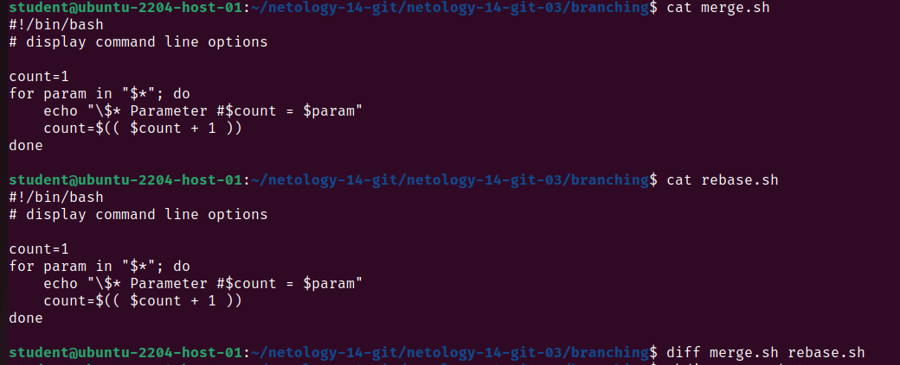
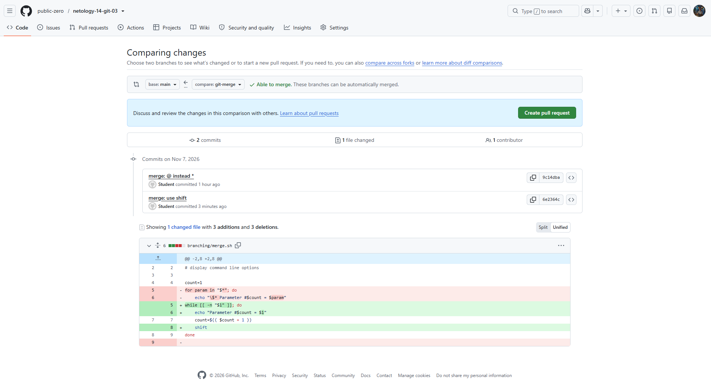
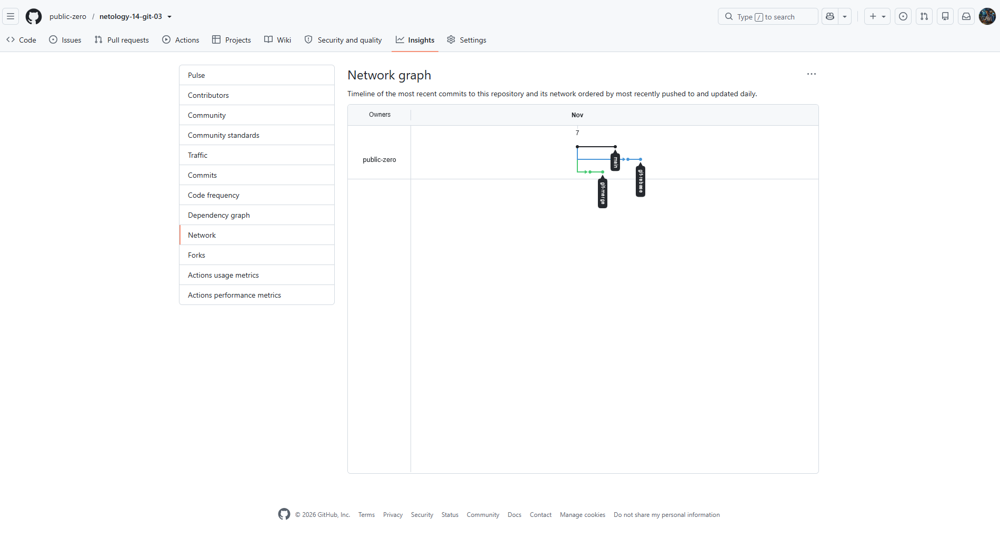
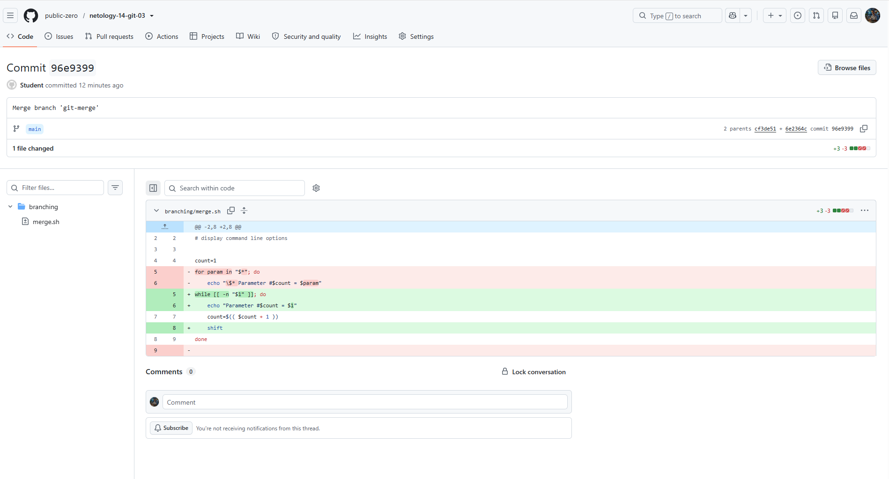
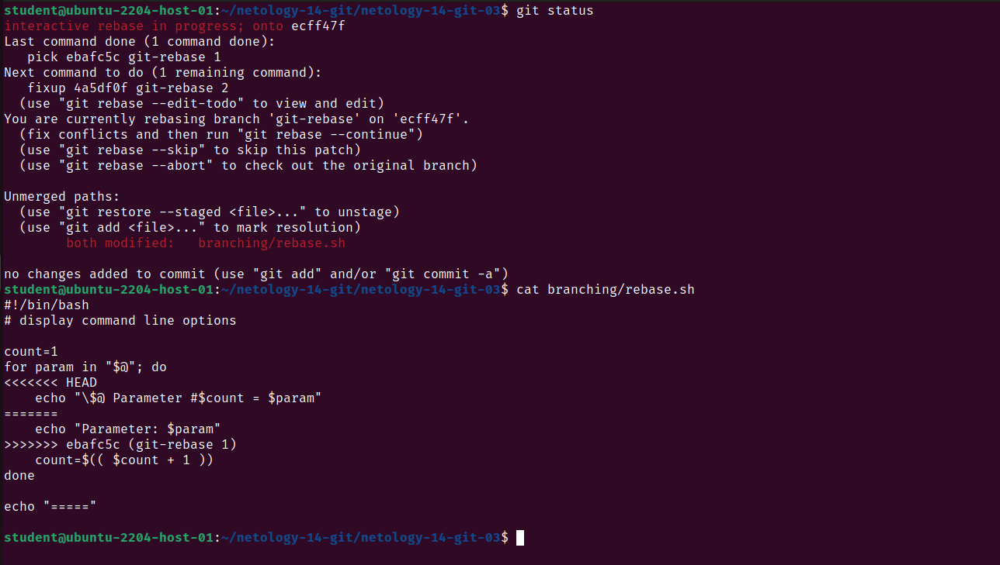
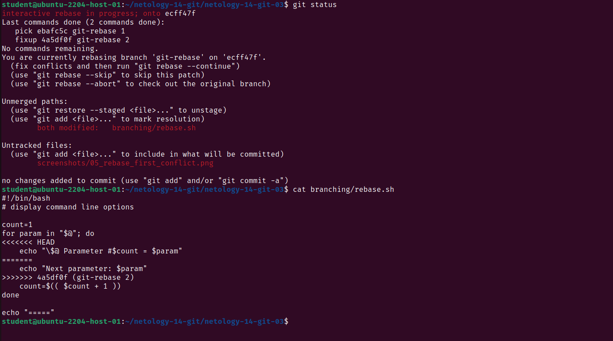
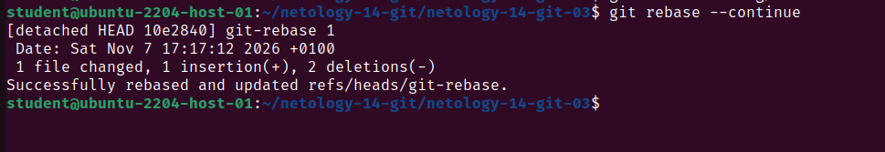
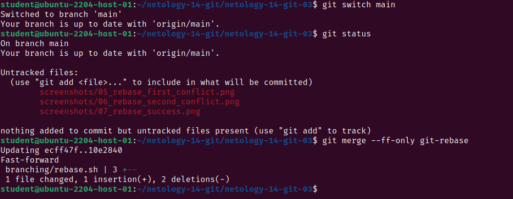
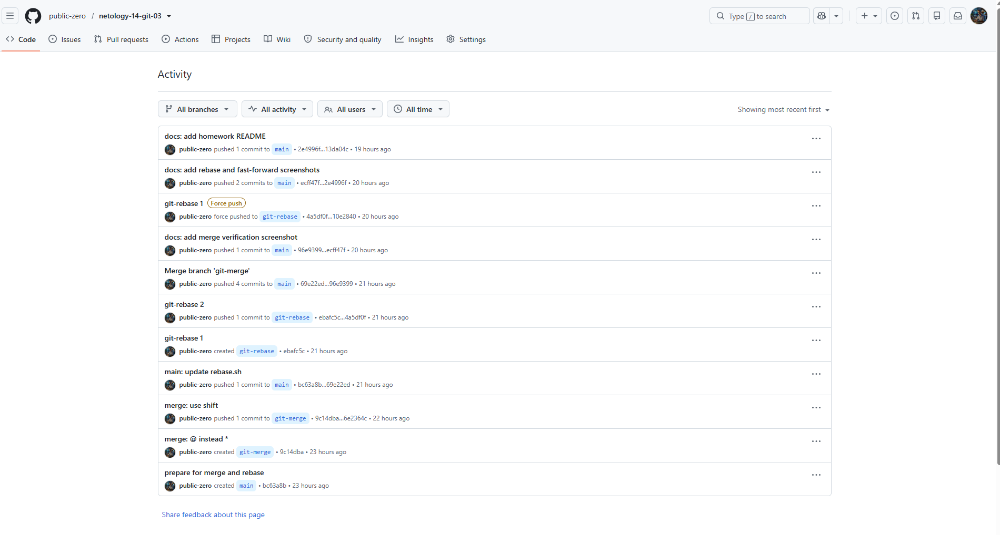

# Домашнее задание «Ветвления в Git»

## Выполнил VO

## 1. Подготовка репозитория

Создал репозиторий `netology-14-git-03`.

В ветке `main` создал папку `branching` и два файла:

- `merge.sh`
- `rebase.sh`

В оба файла добавил одинаковый скрипт из задания. 

Первый коммит:

`prepare for merge and rebase`

Исходное содержимое файлов:



---

## 2. Ветки git-merge и git-rebase

### 2.1. Ветка git-merge

Создал отдельную ветку `git-merge`:

```
git switch -c git-merge
```

В этой ветке изменил файл `merge.sh`.

**Первое изменение**

Заменил `"$*"` на `"$@"`, чтобы скрипт обрабатывал каждый параметр отдельно.

Создал коммит:

`merge: @ instead *`

**Второе изменение**

Заменил цикл `for` на цикл `while` с командой `shift`.

Теперь скрипт последовательно обрабатывает параметры, выводит каждый параметр на отдельной строке и переходит к следующему.

Итоговый код `merge.sh`:

```
#!/bin/bash
# display command line options

count=1
while [[ -n "$1" ]]; do
    echo "Parameter #$count = $1"
    count=$(( $count + 1 ))
    shift
done
```

Создал второй коммит:

`merge: use shift`

Оба коммита отправил на GitHub в ветку `git-merge`.



### 2.2. Изменение ветки main

Вернулся в ветку `main` и изменил файл `rebase.sh`.

Заменил `"$*"` на `"$@"`, изменил вывод параметров и добавил в конце строку:

```
echo "====="
```

Создал коммит:

`main: update rebase.sh`

Изменения отправил на GitHub.

### 2.3. Ветка git-rebase

По условию задания нужно было создать ветку от старого коммита, а не от последней версии `main`.

Нашёл исходный коммит `bc63a8b` и выполнил:

```
git checkout bc63a8b
git switch -c git-rebase
```

В результате создал ветку `git-rebase` от первоначального состояния файлов.

В этой ветке дважды изменил файл `rebase.sh`.

**Первое изменение**

Заменил строку вывода параметров на:

```
echo "Parameter: $param"
```

Создал коммит:

`git-rebase 1`

**Второе изменение**

Изменил эту же строку:

```
echo "Next parameter: $param"
```

Создал коммит:

`git-rebase 2`

Оба коммита отправил на GitHub в ветку `git-rebase`.

### 2.4. Результат

Получились три ветки:

- `main` — основная ветка;
- `git-merge` — ветка с двумя изменениями файла `merge.sh`;
- `git-rebase` — ветка с двумя изменениями файла `rebase.sh`.

График GitHub Network до объединения веток:



---

## 3. Объединение через merge

Переключился на ветку `main` и выполнил:

```
git merge git-merge
```

Результат:

```
Merge made by the 'ort' strategy.
 branching/merge.sh | 6 +++---
 1 file changed, 3 insertions(+), 3 deletions(-)
```

Объединение прошло без конфликтов.

Причина в том, что в ветке `git-merge` изменялся файл `merge.sh`, а в ветке `main` — файл `rebase.sh`.

Git создал отдельный коммит:

`96e9399 Merge branch 'git-merge'`

На GitHub проверил этот коммит. У него два родительских коммита, то есть он соединяет две истории изменений.



После чего отправил обновлённую ветку `main` на GitHub.

---

## 4. Выполнение rebase и решение конфликтов

Теперь нужно было перенести изменения ветки `git-rebase` на обновлённую ветку `main`.

Переключился на `git-rebase` и запустил:

```
git switch git-rebase
git rebase -i main
```

В открывшемся редакторе было два коммита.

Указал следующие действия:

```
pick ebafc5c git-rebase 1
fixup 4a5df0f git-rebase 2
```

Здесь `pick` означает применение первого коммита, а `fixup` — объединение второго коммита с первым.

При выполнении `rebase` Git обнаружил два конфликта в файле `rebase.sh`.

### 4.1. Первый конфликт

Первый конфликт появился при применении коммита `git-rebase 1`.

В файле Git показал два разных варианта одной строки:

```
<<<<<<< HEAD
    echo "\$@ Parameter #$count = $param"
=======
    echo "Parameter: $param"
>>>>>>> ebafc5c (git-rebase 1)
```

По условию задания нужно было оставить вариант из `main`:

```
echo "\$@ Parameter #$count = $param"
```

Открыл файл, удалил второй вариант и все метки конфликта.



После исправления выполнил:

```
git add branching/rebase.sh
git rebase --continue
```

Git продолжил перенос изменений.

### 4.2. Второй конфликт

Следующий конфликт возник при применении коммита `git-rebase 2`.

Git снова обнаружил разные изменения одной строки:

```
<<<<<<< HEAD
    echo "\$@ Parameter #$count = $param"
=======
    echo "Next parameter: $param"
>>>>>>> 4a5df0f (git-rebase 2)
```

На этот раз по условию задания нужно было оставить вариант из второго коммита:

```
echo "Next parameter: $param"
```

Удалил ненужную строку и метки конфликта.



Затем выполнил:

```
git add branching/rebase.sh
git rebase --continue
```

После этого Git завершил перенос изменений.

---

## 5. Объединение коммитов через fixup

При выполнении `rebase` использовал `fixup`, чтобы объединить два коммита ветки `git-rebase` в один.

После разрешения конфликтов Git создал новый коммит:

`10e2840 git-rebase 1`

В нём находятся итоговые изменения двух предыдущих коммитов.

Git вывел сообщение:

```
Successfully rebased and updated refs/heads/git-rebase.
```



После этого попробовал отправить изменения обычной командой:

```
git push
```

Вышла ошибка:

```
! [rejected] git-rebase -> git-rebase (non-fast-forward)
```

Это произошло потому, что `rebase` изменил историю локальной ветки, а на GitHub оставалась старая история.

Для отправки новой истории выполнил:

```
git push --force-with-lease origin git-rebase
```

Результат:

```
+ 4a5df0f...10e2840 git-rebase -> git-rebase (forced update)
```

После этой команды история ветки `git-rebase` на GitHub была обновлена.

---

## 6. Финальное объединение через Fast-forward

После завершения `rebase` вернулся в ветку `main`:

```
git switch main
```

Затем выполнил:

```
git merge --ff-only git-rebase
```

Результат:

```
Updating ecff47f..10e2840
Fast-forward
 branching/rebase.sh | 3 +--
 1 file changed, 1 insertion(+), 2 deletions(-)
```

Объединение прошло без конфликтов.

В этот раз Git не создал отдельный merge-коммит. Вместо этого указатель `main` просто переместился на последний коммит ветки `git-rebase`.

Это объединение Fast-forward.



После объединения добавил скриншоты в репозиторий и отправил изменения на GitHub.


---

## 7. Проверка истории на GitHub

На странице GitHub Activity проверил историю изменений репозитория. Видны первый `merge`, принудительная отправка изменений после `rebase` и обновление ветки `main`.


